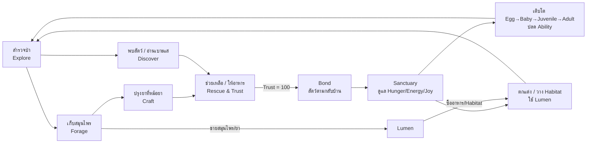

# Mythical Sanctuary — Game Design Document (GDD)

| รายการ | ค่า |
|---|---|
| เอกสาร | GDD — Phase 1 Vertical Slice |
| Build | `Config.Version = "0.1.0-vertical-slice"` |
| แพลตฟอร์ม | Roblox (PC / Mobile / Console — input รองรับทั้ง 3) |
| แนวเกม | Cozy-Fantasy Open-World Creature-Care RPG |
| Source of truth | `src/shared/Config.lua`, `Species.lua`, `Items.lua`, `Quests.lua`, `WorldLayout.lua`, `AssetRegistry.lua` |
| เอกสารที่เกี่ยวข้อง | [ART_DIRECTION.md](ART_DIRECTION.md) · [WORLD_DESIGN.md](WORLD_DESIGN.md) · [ASSET_SPEC.md](ASSET_SPEC.md) · [CONCEPT_BRIEFS.md](CONCEPT_BRIEFS.md) |

> **กฎของเอกสารนี้:** ตัวเลข, ID และ Key ทุกตัวในเอกสารคัดลอกมาจากไฟล์ Luau ใน `src/shared/` ถ้าเอกสารกับโค้ดขัดกัน **โค้ดถูกเสมอ** และต้องแก้เอกสาร (หรือเปิด ticket ให้ Game Design ตัดสิน) ห้ามแก้ตัวเลขในเอกสารโดยไม่แก้ `Config.lua`

---

## 1. Vision

**"โลกที่สัตว์เวทมนตร์ไว้ใจคุณ เพราะคุณอ่อนโยนกับมัน"**

ผู้เล่นคือผู้มาใหม่ใน **Mystic Village** หมู่บ้านเล็ก ๆ ริมป่า **Whispering Forest** ผู้เฒ่ามาริเบลได้ยินว่าป่ากำลัง "เรียก" ใครบางคน ผู้เล่นจะได้เรียนรู้การเก็บสมุนไพร ปรุงยา ช่วยเหลือสัตว์ที่บาดเจ็บ และค่อย ๆ สร้างความไว้วางใจจนสัตว์ยอมตามกลับไปอยู่ใน **Sanctuary** เขตอนุรักษ์ส่วนตัวบนเกาะลอยฟ้าที่ผู้เล่นตกแต่งเอง

ความรู้สึกที่ต้องการ: อบอุ่น, อยากรู้อยากเห็น, ภูมิใจเมื่อสัตว์ขี้กลัวยอมเดินเข้ามาหา — *ไม่ใช่* ความตื่นเต้นจากการต่อสู้หรือการล่า

### 1.1 Elevator pitch
> เดินย่อตัวเข้าหาจิ้งจอกที่หางเรืองแสงสีฟ้า ยื่นพลัมวิญญาณให้ มันลังเล… แล้วหางก็เปลี่ยนเป็นสีทอง นั่นคือวินาทีที่ผู้เล่นจะจำได้

### 1.2 Design Pillars

| # | Pillar | ความหมาย | ทดสอบได้ด้วยคำถาม |
|---|---|---|---|
| P1 | **Trust over Force** | ไม่มีการต่อสู้ ไม่มีการจับด้วยกำลัง ไม่มีลูกบอล/กรง สัตว์เลือกผู้เล่นเอง | "ฟีเจอร์นี้ทำให้ผู้เล่นได้สัตว์มาโดยที่สัตว์ไม่ได้เลือกหรือเปล่า?" ถ้าใช่ = ตัดทิ้ง |
| P2 | **Cozy** | ไม่มีความล้มเหลวที่ลงโทษหนัก สัตว์ไม่ตาย ไม่หนีออกจากเขตอนุรักษ์ ไม่มี timer กดดัน | "ผู้เล่นที่หายไป 1 สัปดาห์กลับมาแล้วรู้สึกผิดไหม?" ต้องตอบว่าไม่ (`OfflineDecayCapHours = 6`) |
| P3 | **Discovery** | โลกให้รางวัลคนที่สังเกต: เบาะแสสัตว์, สถานที่ลับ, สัตว์ที่ออกเฉพาะเวลา | "ถ้าผู้เล่นเดินออกนอกทาง จะเจออะไรไหม?" ต้องมีเสมอ |
| P4 | **Handcrafted World** | ทุก landmark วางด้วยมือตาม composition, พืชกระจายด้วยกฎ (Poisson-disk + exclusion) ไม่ใช่สุ่มมั่ว | "ภาพนี้ screenshot แล้วใช้เป็น key art ได้ไหม?" |

### 1.3 Non-goals (Phase 1)
- ไม่มี PvP, ไม่มี combat, ไม่มีสัตว์ "ตาย"
- ไม่มีการเทรดสัตว์ระหว่างผู้เล่น (ขัดกับ P1 — สัตว์ผูกพันกับคน ไม่ใช่สินค้า)
- ไม่มีระบบเงินจริงใด ๆ

---

## 2. Target Audience

| กลุ่ม | อายุ | แรงจูงใจหลัก | สิ่งที่ต้องมีให้เขา |
|---|---|---|---|
| **Primary — Cozy Collectors** | 9–15 | สะสม, ดูแล, ตกแต่ง, ถ่ายรูปสัตว์ | สัตว์น่ารักที่มีบุคลิก, Sanctuary ที่ตกแต่งได้, Bestiary |
| **Secondary — Explorers** | 12–18 | ค้นหาสิ่งลับ, ทำ 100% | ถ้ำลับ, สัตว์กลางคืน, เบาะแส (`Clues`) |
| **Tertiary — Social Decorators** | 10–16 | อวด Sanctuary ให้เพื่อน | (Phase 2) เยี่ยม Sanctuary เพื่อน |

ข้อกำหนดที่ตามมา: อ่านง่าย (ข้อความสั้น, ไอคอนชัด), เล่นบนมือถือได้ (ปุ่ม Sneak บนจอ), session สั้น 10–20 นาทีก็มีความคืบหน้า, เนื้อหาไม่มีความรุนแรง

---

## 3. Core Loop



**ASCII fallback**

```
   ┌──────────── Explore ◄───────────────────────────┐
   │      │                                          │
   ▼      ▼                                          │
Forage  Discover (Clues / Bestiary)                  │
   │      │                                          │
   ▼      │                                          │
 Craft ───┼──► Rescue / Feed / Sneak ──► Trust 100 ──► Bond
   │      │                                          │
   ▼      │                                          ▼
 Sell → Lumen → Buy food / Habitats ──► Sanctuary: Care → Grow → Ability
```

### 3.1 Loop timings (เป้าหมาย)

| Loop | ระยะเวลา | ตัวอย่าง |
|---|---|---|
| Micro (วินาที) | 2–10 วิ | เก็บสมุนไพร 1 ต้น, ยื่นอาหาร 1 ครั้ง (`InteractCooldown = 2.5`), ลูบหัว (`PetCooldown = 4`) |
| Session (นาที) | 10–20 นาที | วิ่งรอบป่าเก็บของ → ปรุงยา → ผูกพันสัตว์ 1 ตัว |
| Daily (ชั่วโมง) | 1 วันในเกม = 24 นาทีจริง | สัตว์กลางวัน/กลางคืนสลับกันออก, Treasure Mole `Dig` วันละครั้ง |
| Long (สัปดาห์) | หลายวัน | เลี้ยงสัตว์ถึง Adult, ทำ Bestiary ครบ, ตกแต่ง Sanctuary 150 ชิ้น |

---

## 4. Core Systems (Phase 1)

### 4.1 Time & Weather

| พารามิเตอร์ | ค่า | หมายเหตุ |
|---|---|---|
| `DayLengthMinutes` | 24 | 1 ชั่วโมงในเกม = 1 นาทีจริง |
| `StartClockTime` | 9 | เซิร์ฟเวอร์ใหม่เริ่ม 09:00 |
| ช่วงเวลา (ใช้กับ `ActiveTime`) | Day / Dusk / Night / Any | แนะนำ Day 07–17, Dusk 17–20, Night 20–05, Dawn 05–07 (นับเป็น Day) — *ค่าตัดช่วงจริงอยู่ใน TimeService ของโค้ด* |
| Weather | Clear / Cloudy / Rain | Rain เล่น `Ambience_Rain`, Atmosphere หนาขึ้น (ดู ART_DIRECTION §6) |

### 4.2 Player movement

| สถานะ | WalkSpeed | ผลต่อสัตว์ |
|---|---|---|
| Sneak (ย่อตัว, Ctrl / ปุ่มบนจอ) | `SneakWalkSpeed = 8` | ทุกครั้งที่อยู่ใกล้สัตว์ขณะย่อ: Trust `+6` (`CalmWhileSneaking`) |
| Walk | `NormalWalkSpeed = 16` | ปกติ |
| Run | `RunSpeed = 24` | วิ่งเข้าใส่สัตว์ในระยะ Flee: Trust `-10` (`CalmWhileRunning`) + สัตว์เข้า state Flee |

### 4.3 Creature AI

State machine: **Wander → Forage → Drink → Sleep → Play → Flee → Approach → Idle**

| State | เงื่อนไขเข้า | พฤติกรรม | แอนิเมชันที่ใช้ |
|---|---|---|---|
| Idle | default / หลังจบ state อื่น | ยืนมองรอบ ๆ | `Idle` |
| Wander | สุ่มจุดในรัศมี `WanderRadius` จาก spawn center | เดินช้า | `Walk` |
| Forage | หิว (wild: สุ่มตามเวลา) | ก้มหาอาหาร | `Eat` |
| Drink | ใกล้แม่น้ำ / Spring Pond | ดื่มน้ำ | `Drink` |
| Sleep | นอก `ActiveTime` ของสายพันธุ์ / Energy ต่ำ | นอนขด | `Sleep` |
| Play | `PlayChance` ของบุคลิก | กระโดดเล่น | `Play` |
| Flee | ผู้เล่นวิ่งเข้าในระยะ `FleeDistance × FleeMult` | วิ่งหนี | `Run`, `Scared` |
| Approach | `ApproachChance` + Trust สูง | เดินเข้าหาผู้เล่น | `Walk`, `Happy` |

**LOD & Performance**

| พารามิเตอร์ | ค่า |
|---|---|
| `NearDistance` / `NearTick` | ≤ 160 studs → คิดทุก 0.25 วิ |
| `FarDistance` / `FarTick` | ≤ 420 studs → คิดทุก 2 วิ; ไกลกว่านี้ = dormant (ไม่ประมวลผล) |
| `PathfindingMinDistance` | > 40 studs ใช้ `PathfindingService`, ใกล้กว่าใช้ `MoveTo` ตรง |
| `MaxWildPerSpawnArea` | 3 ตัว × 6 Spawn Areas = สูงสุด 18 ตัวป่าทั้งแมพ |
| `RespawnSeconds` | 120 |

**ค่าต่อสายพันธุ์ (Phase 1)**

| Species | Rarity | ActiveTime | Walk/Run | FleeDistance | WanderRadius | Favorite | Likes | Dislikes |
|---|---|---|---|---|---|---|---|---|
| `spirit_kitsune` | Uncommon | Dusk | 10 / 26 | 22 | 60 | `spirit_plum` | glowberry, spirit_plum | crystal_grub |
| `lunar_stag` | Rare | Night | 8 / 30 | 34 | 80 | `moonleaf` | moonleaf, glowberry | honeyroot |
| `treasure_mole` | Common | Day | 7 / 14 | 14 | 45 | `crystal_grub` | crystal_grub, honeyroot | moonleaf |

**Personalities** (สุ่ม 1 จากรายการ `Personalities` ของสายพันธุ์ตอนเกิด)

| Id | ชื่อไทย | TrustMult | FleeMult | PlayChance | ApproachChance |
|---|---|---|---|---|---|
| Playful | ขี้เล่น | 1.2 | 0.8 | 0.35 | 0.25 |
| Shy | ขี้กลัว | 0.75 | 1.5 | 0.10 | 0.05 |
| Curious | อยากรู้อยากเห็น | 1.1 | 0.9 | 0.20 | 0.40 |
| Solitary | รักสันโดษ | 0.9 | 1.1 | 0.05 | 0.10 |

ตัวอย่าง: กวางจันทรานิสัย Shy → ระยะหนีจริง 34 × 1.5 = **51 studs** ผู้เล่นต้องย่อตัวตั้งแต่ไกล

### 4.4 Taming — Trust (ไม่ใช้กำลัง)

| Action | Trust Δ | หมายเหตุ |
|---|---|---|
| ให้อาหารโปรด (`Favorite`) | +22 | `OfferFavoriteFood` |
| ให้อาหารที่ชอบ / ทั่วไป | +9 | `OfferFood` |
| ให้อาหารที่ไม่ชอบ (`Dislikes`) | −6 | `OfferDislikedFood` — สัตว์ทำท่า `Scared` เล็กน้อยแล้วเมิน |
| อยู่ใกล้ขณะย่อตัว | +6 | `CalmWhileSneaking` |
| วิ่งเข้าใส่ | −10 | `CalmWhileRunning` |
| รักษาสัตว์บาดเจ็บด้วย `healing_salve` | +45 | `HealInjured` — Rescue |
| เดินจากไป | −2 / นาที | `DecayPerMinute` |
| Cooldown ระหว่าง interaction | 2.5 วิ | `InteractCooldown` |
| **Bond** | Trust ≥ 100 | `BondThreshold = 100` (`Max = 100`) → สัตว์ยอมตามไป Sanctuary |

Design intent: ค่าบวกคูณ `TrustMult` ของบุคลิก (ค่าลบไม่คูณ เพื่อไม่ลงโทษผู้เล่นซ้ำกับสัตว์ขี้กลัว) — **โค้ดต้องยืนยันการคำนวณนี้ใน TamingService**

ตัวอย่างการคำนวณ (Kitsune, Playful ×1.2): Rescue 45×1.2 = 54 → + อาหารโปรด 2 ครั้ง (26.4×2) = 106.8 → Bond ในการพบครั้งเดียว ~1 นาที
Kitsune Shy (×0.75): Rescue 33.75 + โปรด 16.5 × 4 = 99.75 → ต้อง Sneak อีก 1 ครั้ง — ยากขึ้นแต่ไม่ทรมาน

`calming_draught` (ยาสงบใจ): สัตว์ขี้กลัวไม่หนีชั่วครู่และไว้ใจเร็วขึ้น — ระยะเวลาและตัวคูณอยู่ในโค้ด (ยังไม่มีใน `Config.Trust`; ดู §10 Open Issues)

### 4.5 Care (ใน Sanctuary)

ค่า 0–100 สามตัว: **Hunger, Energy, Joy** ลดลงทุก `TickSeconds = 30`

| ค่า | ลดต่อ tick | ต่อนาที | เต็ม → 0 ใช้เวลา |
|---|---|---|---|
| Hunger | 2.5 | 5.0 | 20 นาที |
| Energy | 1.5 | 3.0 | ~33 นาที |
| Joy | 1.2 | 2.4 | ~42 นาที |

| Action | ผล | Care XP | Cooldown |
|---|---|---|---|
| Feed | Hunger +30 (`FeedHunger`) | +6 | `InteractCooldown` |
| Feed Favorite | Hunger +30, Joy +12 (`FeedFavoriteJoy`) | +10 | — |
| Pet | Joy +8 (`PetJoy`) | +3 | 4 วิ (`PetCooldown`) |
| Play | Joy +18 (`PlayJoy`), Energy −10 (`PlayEnergyCost`) | +8 | — |
| Sleep (อัตโนมัติ) | Energy +8 / tick (`SleepEnergyPerTick`) | — | — |

**Cozy guarantee:** ออฟไลน์นานแค่ไหน ค่าลดสูงสุดเท่ากับ `OfflineDecayCapHours = 6` ชั่วโมง สัตว์ **ไม่ตาย ไม่หนี** แค่ทำหน้าเศร้าและวิ่งมาหาเมื่อผู้เล่นกลับมา

### 4.6 Growth

| Stage | เงื่อนไขขึ้น stage ถัดไป | Scale (Kitsune / Stag / Mole) |
|---|---|---|
| Egg | ฟัก `EggHatchSeconds = 480` (8 นาที) ใน `incubator` (Hatchery Nest) | (ไม่มีใน `Species.Size` — ใช้ขนาดโมเดล Egg ตรง ๆ) |
| Baby | Care XP ≥ 120 (`CareXPToJuvenile`) และ Joy ≥ 50 (`MinJoyToGrow`) | 0.45 / 0.5 / 0.5 |
| Juvenile | Care XP ≥ 400 (`CareXPToAdult`) และ Joy ≥ 50 | 0.7 / 0.75 / 0.75 |
| Adult | — (ปลด Ability เต็มรูปแบบ) | 1.0 / 1.0 / 1.0 |

ตัวอย่าง: Baby → Juvenile ด้วย Feed Favorite อย่างเดียว = 12 ครั้ง (ข้อจำกัดคือ Hunger: ป้อนได้จริงราว 1 ครั้งต่อ 6 นาที) → ผสม Pet/Play ได้ราว 1 session; Juvenile → Adult ~2–3 sessions. `growth_tonic` เพิ่ม Care XP เพื่อเร่ง (ค่าใน ItemService)

### 4.7 Sanctuary

| พารามิเตอร์ | ค่า |
|---|---|
| ตำแหน่งเกาะ | `PlotOrigin = (6000, 0, 0)` + `PlotSpacing = 1400` × index ของผู้เล่นในเซิร์ฟเวอร์ |
| เข้า/ออก | `Landmark_SanctuaryGate` (หมู่บ้าน) ⇄ `Sanctuary_ReturnGate` (บนเกาะ) |
| พื้นที่วางของ | รัศมี `BuildRadius = 150` studs |
| Grid | `GridSize = 2` studs, หมุนทีละ 90° |
| ของที่วางได้สูงสุด | `MaxPlacedObjects = 150` |
| สัตว์สูงสุด | `MaxCreatures = 12` |
| อาคารประจำเกาะ | `Sanctuary_Cottage`, `Sanctuary_Cauldron` (หม้อยาส่วนตัว) |

ของที่วางได้ (`Placeable = true`) — Footprint ทุกชิ้นเป็นเลขคู่ จึงลง Grid 2 studs พอดี:

| Item Id | AssetKey | Footprint | Price (Lumen) |
|---|---|---|---|
| `habitat_kitsune_den` | `Habitat_KitsuneDen` | 10×10 | 150 |
| `habitat_moon_glade` | `Habitat_MoonGlade` | 14×14 | 220 |
| `habitat_mole_burrow` | `Habitat_MoleBurrow` | 8×8 | 120 |
| `incubator` | `Prop_HatcheryNest` | 6×6 | 80 |
| `decor_lantern` | `Prop_FloatingLantern` | 2×2 | 25 |
| `decor_mushroom_lamp` | `Prop_GlowcapCluster` | 4×4 | 30 |
| `decor_bench` | `Prop_RootBench` | 6×2 | 40 |
| `decor_flowerbed` | `Prop_WildflowerPatch` | 6×6 | 20 |
| `decor_stone_arch` | `Prop_RuneArch` | 8×4 | 90 |
| `decor_pond` | `Prop_SpringPond` | 12×12 | 110 |

### 4.8 Forage

| พารามิเตอร์ | ค่า |
|---|---|
| `Forage.RespawnSeconds` | 90 (ต่อผู้เล่น ต่อ node) |
| `Forage.InteractDistance` | 10 studs |
| Nodes ทั้งหมด | 18 (silverfern 6, dewcap 6, wisp_lily 4, honeyroot 2) — ตำแหน่งดู WORLD_DESIGN §3 |

| Herb | SellPrice | แหล่ง |
|---|---|---|
| `silverfern` | 3 | ริมทางป่า |
| `dewcap` | 4 | ใต้ต้นไม้ผู้เฒ่า, ซากวิหาร, ในถ้ำลับ |
| `wisp_lily` | 8 | ทุ่งดอกไม้ริมน้ำตก, ถ้ำลับ (บานกลางคืน) |
| `honeyroot` (Food) | ซื้อ 8 | 2 nodes ในป่า + ร้าน |

### 4.9 Crafting (Cauldron)

สถานี: `Prop_Cauldron_Public` (หน้า Apothecary) และ `Sanctuary_Cauldron`

| Recipe | Inputs | Output | Seconds | SellPrice |
|---|---|---|---|---|
| `healing_salve` | silverfern ×2, dewcap ×1 | 1 | 3 | 20 |
| `calming_draught` | wisp_lily ×1, silverfern ×1 | 1 | 3 | 24 |
| `growth_tonic` | dewcap ×2, wisp_lily ×1, honeyroot ×1 | 1 | 4 | 40 |

### 4.10 Economy — Lumen

| แหล่งเข้า | ค่า |
|---|---|
| เริ่มเกม | `StartingCoins = 120`, `StartingItems = { glowberry = 6, silverfern = 2 }` |
| Quest chain รวม (q01–q08) | 710 Lumen |
| ขายสมุนไพร/ยา | ตาม `SellPrice` |

| แหล่งออก | ราคา |
|---|---|
| อาหาร | glowberry 6, honeyroot 8, crystal_grub 14, moonleaf 16, spirit_plum 18 |
| Habitat / Decor | 20–220 (ตาราง §4.7) |

Sanity check: จบ quest chain มีราว 830 Lumen (+ รายได้ขายของ) พอซื้อ Moon Glade + Mole Burrow + decor ชุดเล็ก — ผู้เล่นรู้สึก "มีของให้ซื้อต่อ" แต่ไม่ขาดแคลน

### 4.11 Player Progression (Level)

`Config.LevelXP(level) = 100 + (level − 1) × 60` = XP ที่ต้องใช้จาก level นั้นไป level ถัดไป

| Level | XP ต่อ level | XP สะสม |
|---|---|---|
| 1 → 2 | 100 | 100 |
| 2 → 3 | 160 | 260 |
| 3 → 4 | 220 | 480 |
| 4 → 5 | 280 | 760 |
| 5 → 6 | 340 | 1,100 |
| 6 → 7 | 400 | 1,500 |

Quest chain ให้ XP รวม **1,180** → จบบทนำผู้เล่นอยู่ราว **Level 6** (ไม่รวม XP จากกิจกรรมอื่น) Phase 1 ใช้ Level เป็นตัวบอกความคืบหน้า; การปลดล็อกตาม Level (เช่น BuildRadius ขยาย) เป็นงาน Phase 2

### 4.12 Bestiary (สมุดภาพสัตว์ — NPC Quill)

- บันทึกเมื่อ `Discover` สัตว์ครั้งแรก: ชื่อ, ชื่อไทย, Element, Rarity, ActiveTime, Lore
- `Clues` ของสายพันธุ์แสดงเป็น "?" จนกว่าผู้เล่นจะเห็นเบาะแสนั้นในโลก (Discovery pillar)
- Likes/Dislikes เปิดเผยเมื่อผู้เล่นลองให้อาหารชนิดนั้น
- Phase 3 species แสดงเป็นเงา (silhouette) + ชื่อโซน เพื่อปั่นความอยากรู้

### 4.13 NPCs & Schedules

| Id | ชื่อ | Role | Home | ตาราง (ชั่วโมงในเกม → ตำแหน่ง) |
|---|---|---|---|---|
| `npc_elder` | Elder Maribel / ผู้เฒ่ามาริเบล | QuestGiver | (8,0,14) ข้างหอนาฬิกา | 06 → หอนาฬิกา · 20 → บ้าน (−120,0,10) |
| `npc_bramble` | Bramble / แบรมเบิล | Shop (อาหาร/Habitat) | (−34,0,−26) Feed Shop | 07 → ร้าน · 19 → บ้าน (−110,0,−60) |
| `npc_willow` | Willow / วิลโลว์ | Crafting | (48,0,−22) Apothecary | 08 → ร้าน · 21 → บ้าน (85,0,−75) |
| `npc_quill` | Quill / ควิลล์ | Bestiary | (−72,0,40) Library | 09 และ 22 → ห้องสมุด (อยู่ทั้งวัน) |
| `npc_pip` | Pip / พิป | Villager | (−40,0,95) | 07 แผงตลาด A · 12 หัวสะพาน · 17 จัตุรัส · 20 บ้าน |
| `npc_rowan` | Rowan / โรแวน | Villager | (70,0,70) | 06 ประตูเหนือ · 11 แผงตลาด B · 18 บ้าน |

ร้านปิดตอนกลางคืน (NPC กลับบ้าน) → การซื้อของต้องวางแผนตามเวลา ซึ่งสอดคล้องกับสัตว์กลางคืน: ผู้เล่นซื้อ `moonleaf` ตอนเย็นแล้วออกไปหากวางจันทรา

### 4.14 Zones & Lighting

| Zone Id | Center | Radius | Priority | Lighting/Music |
|---|---|---|---|---|
| `MysticVillage` | (0,0,10) | 200 | 2 | `Music_Village_Day/Night`, `Ambience_Village` |
| `WhisperingForest` | (0,0,−600) | 560 | 1 | `Music_Forest_Day/Night`, `Ambience_Forest` |
| Sanctuary (เกาะแยก) | PlotOrigin | — | — | `Music_Sanctuary` |

เมื่อวงกลมซ้อนกัน (ขอบหมู่บ้านด้านเหนือ) โซนที่ Priority สูงกว่าชนะ — ค่า Lighting tween ข้ามโซนใน 3 วินาที (ค่าแนะนำใน ART_DIRECTION §6)

### 4.15 Persistence

| พารามิเตอร์ | ค่า |
|---|---|
| `DataStoreName` | `MythicalSanctuary_Player` |
| `DataVersion` | 2 — เพิ่มทุกครั้งที่เปลี่ยน schema + เพิ่ม migration ใน DataService |
| `AutoSaveInterval` | 90 วิ |
| `SessionLockTimeout` | 1,800 วิ (30 นาที) — lock เก่ากว่านี้ถือว่าเซิร์ฟเดิมล่ม |

ข้อมูลที่บันทึก: Lumen, Inventory, Level/XP, Quest state, Bestiary, สัตว์ (species, personality, stage, Care XP, needs, timestamp ล่าสุดสำหรับ offline decay), วัตถุใน Sanctuary (itemId, grid pos, rotation)

### 4.16 Greybox Policy

ทุก Key ใน `AssetRegistry.Environment` ที่ยังไม่มีโมเดลใน `ReplicatedStorage/Assets/<Key>` จะถูกสร้างเป็น **Greybox Blockout** ตาม `Size` และ `Shape` (สีดินเหนียว + แท็ก Placeholder) เพื่อให้ทดสอบ gameplay, scale และ composition ได้ทันที เมื่อ Artist ส่งโมเดลชื่อตรง Key โค้ดจะสลับให้อัตโนมัติ — **Greybox ไม่ใช่งานศิลป์สมบูรณ์ ห้ามนับเป็นงานจบ**

---

## 5. Quest Chain — "เสียงเรียกจากป่า" (Phase 1)

`Quests.First = "q01_arrival"`

| # | Id | Title | Giver | Objectives | Rewards |
|---|---|---|---|---|---|
| 1 | `q01_arrival` | ผู้มาใหม่แห่งมิสติก | npc_elder | Talk npc_elder ×1 | 30 Lumen, 40 XP |
| 2 | `q02_herbs` | สมุนไพรแห่งการเยียวยา | npc_willow | Forage silverfern ×4, dewcap ×2 | 40, 60 XP |
| 3 | `q03_brew` | หม้อยาแรก | npc_willow | Craft healing_salve ×1 | 30, 60 XP, glowberry ×4 |
| 4 | `q04_rescue` | เสียงร้องใต้ต้นไม้ผู้เฒ่า | npc_elder | Discover spirit_kitsune ×1, Rescue spirit_kitsune ×1 | 60, 120 XP |
| 5 | `q05_bond` | สายใยแห่งความไว้วางใจ | npc_elder | Bond spirit_kitsune ×1 | 80, 150 XP, habitat_kitsune_den ×1 |
| 6 | `q06_sanctuary` | บ้านหลังใหม่ | npc_elder | Visit Sanctuary, Place habitat_kitsune_den, Feed any | 120, 200 XP, egg_spirit_kitsune ×1, incubator ×1 |
| 7 | `q07_egg` | ไข่ปริศนา | npc_quill | Place incubator, Hatch any | 150, 250 XP |
| 8 | `q08_explore` | นักสำรวจแห่งป่าเสียงกระซิบ | npc_quill | Discover lunar_stag, Discover treasure_mole, Landmark HiddenCave | 200, 300 XP |
| | | **รวม** | | | **710 Lumen, 1,180 XP** |

โครงสร้างบท: **Teach (q01–q03)** เก็บ/ปรุง → **Emotional hook (q04–q05)** ช่วยจิ้งจอก → **Ownership (q06–q07)** บ้าน + ชีวิตใหม่ → **Release to sandbox (q08)** สำรวจเอง กลางคืน + ที่ลับ

เวลาเล่นเป้าหมายของ chain: 45–60 นาที (ระยะทางเดินจริงดู WORLD_DESIGN §4)

---

## 6. Monetization Philosophy

**Phase 1: ไม่มี monetization ใด ๆ** (ไม่มี Developer Product, Game Pass หรือร้านเงินจริง)

หลักการสำหรับ Phase 2+ (ข้อผูกมัดที่ห้ามละเมิด):

| ✅ อนุญาต | ❌ ห้ามเด็ดขาด |
|---|---|
| Cosmetic: ชุดตกแต่ง Sanctuary ธีมพิเศษ, ชุดผู้เล่น, เครื่องประดับสัตว์ (ผ้าพันคอ, กระดิ่ง), เอฟเฟกต์รอยเท้า | ขายสัตว์, ไข่ หรือ Trust โดยตรง |
| Convenience ที่ไม่ข้ามประสบการณ์หลัก: Layout preset ของ Sanctuary, ช่อง Inventory เพิ่ม, กรอบรูป Photo mode | **Paid random boxes / gacha / loot box ทุกรูปแบบ** |
| Season Pass ที่ track ฟรีให้ของครบทุก gameplay | ของที่เพิ่มพลัง Ability, ความเร็ว Trust, หรือข้ามการดูแล (pay-to-win / pay-to-skip care) |
| ราคาแสดงชัด เห็นของก่อนซื้อ | สกุลเงินซ้อนที่ปิดบังราคาจริง, timer กดดันให้ซื้อ, FOMO ที่ลงโทษผู้เล่นที่ไม่ได้ซื้อ |

กลุ่มเป้าหมายเป็นเด็กและวัยรุ่น ทุกการขายต้องผ่าน review "จะอธิบายให้ผู้ปกครองฟังได้สบายใจไหม?"

---

## 7. Phase Roadmap

| Phase | ชื่อ | ขอบเขต | Exit criteria |
|---|---|---|---|
| **1** | **Vertical Slice** | Mystic Village + Whispering Forest, 3 สายพันธุ์ (Kitsune, Stag, Mole), ระบบหลักครบทุกตัวใน §4, quest chain 8 เควส, Sanctuary พื้นฐาน, Greybox ทุก asset ที่ยังไม่ส่ง + Asset pipeline พร้อมรับงานจริง | Checklist §8 ผ่านทุกข้อฝั่ง Code; Art ส่ง hero asset อย่างน้อย L01, L05, CRE-01 เพื่อพิสูจน์ pipeline |
| **2** | **Production & Social** | แทนที่ Greybox ทั้งหมดด้วย art จริง + audio ครบ `AssetRegistry.Sounds`, เพลง; เยี่ยม Sanctuary เพื่อน; ขยาย BuildRadius ตาม Level; decor เพิ่ม; บทที่ 2 ของเควส; Accessibility (สีตาบอดสี, ขนาดตัวอักษร); เปิด cosmetic shop ตาม §6 | 0 Greybox ใน build, FPS เป้าหมายผ่านบนมือถือระดับกลาง, retention D1/D7 ผ่านเป้า |
| **3** | **World Expansion** | 4 biome ใหม่: Crystal Cavern, Frost Mountains, Ember Valley, Celestial Islands + 5 สายพันธุ์ (`ember_dragon`, `storm_griffin`, `solar_phoenix`, `aqua_serpent`, `shadow_wolf`); Ability ใช้เปิดทางสำรวจ (MoonStep, TideCall, EmberBreath, Gust); การขี่ (ability ของ griffin/wolf อ้างถึง "ผู้ขี่") | ทุก species ใน `Species.List` เปิด (`Phase ≤ 3`) และมี asset ครบ CRE spec |

> หมายเหตุ: ข้อมูลของ 5 สายพันธุ์ Phase 3 อยู่ใน `Species.lua` แล้ว (ระบบเปิดใช้ผ่าน `Species.IsEnabled(id, currentPhase)`) แต่ยังไม่มีโซน, item อาหาร และ habitat ที่อ้างถึง — ดู §10

---

## 8. Acceptance Criteria — Phase 1

สัญลักษณ์: **[C]** = โค้ด Phase 1 ครอบคลุม (ทดสอบได้กับ Greybox) · **[A]** = ต้องรอ Art/Audio จริง · **[C+A]** = โค้ดพร้อม, คุณภาพสุดท้ายขึ้นกับ art

### World
- [ ] [C] Terrain voxel สร้างจาก `WorldLayout.Terrain/Village/River/Paths/Features/HiddenCave` ตรงพิกัด (VoxelSize 4)
- [ ] [C] ขอบโลกเป็นหน้าผา `RimHeight 150 / RimWidth 140` ผู้เล่นออกนอกแมพไม่ได้
- [ ] [C] Landmark 24 จุด + Hero trees 6 ต้นวางตามพิกัด/Yaw/Scale
- [ ] [C] Scatter 5 กฎ (รวม 1,560 instances) เคารพ MinSpacing, KeepOffPaths, KeepOffRiver, MaxSlope
- [ ] [C] เข้าถ้ำลับได้ผ่าน HiddenTrail และอุโมงค์
- [ ] [A] โมเดลจริงทุก Key ใน ASSET_SPEC §2 (58 keys) แทน Greybox
- [ ] [C+A] Per-zone lighting profile + day/night + weather (ค่าใน ART_DIRECTION §6)

### Creatures
- [ ] [C] AI state machine 8 states + LOD (160/420 studs) + Pathfinding > 40 studs
- [ ] [C] 6 Spawn Areas, ≤ 3 ตัวต่อพื้นที่, respawn 120 วิ, เคารพ ActiveTime
- [ ] [C] Personality สุ่มและส่งผลต่อ Trust/Flee/Play/Approach
- [ ] [A] โมเดล `Creature_<speciesId>_<Stage>` 12 ตัว (3 species × 4 stages) + ริก CRE-RIG
- [ ] [A] แอนิเมชัน 10 ชื่อ × 3 species (Egg ใช้ชุดย่อย ดู ASSET_SPEC)
- [ ] [C] Fallback: ถ้าไม่มีแอนิเมชัน ระบบยังทำงาน (Greybox creature เลื่อนตัวได้)

### Taming / Care / Growth
- [ ] [C] Sneak (8) / Walk (16) / Run (24) และผลต่อ Trust ตาม `Config.Trust`
- [ ] [C] Rescue ด้วย `healing_salve` (+45), Bond ที่ 100, decay 2/นาที
- [ ] [C] Hunger/Energy/Joy tick ทุก 30 วิ, offline cap 6 ชม.
- [ ] [C] Egg ฟัก 480 วิ, Baby→Juvenile 120 Care XP, →Adult 400, Joy ≥ 50
- [ ] [C+A] Ability VFX (WispLight / MoonStep / Dig) — logic [C], VFX texture/particle [A]

### Sanctuary
- [ ] [C] เกาะ terrain แยกต่อผู้เล่นที่ (6000,0,0) + 1400×index, เข้า/ออกผ่าน portal
- [ ] [C] วางของ grid 2 studs, หมุน 90°, รัศมี 150, ≤ 150 ชิ้น, ≤ 12 สัตว์
- [ ] [A] Habitat/Decor/อาคาร SAN-* 12 keys

### Economy / Crafting / Quest / UI
- [ ] [C] Forage 18 nodes, respawn 90 วิ, ระยะ 10 studs
- [ ] [C] 3 สูตรที่ Cauldron (3–4 วิ)
- [ ] [C] Quest chain q01→q08 เล่นจบได้ต่อเนื่อง, reward ตรงตาราง §5
- [ ] [C] Bestiary, Shop (Bramble), NPC schedule 6 ตัว
- [ ] [C] UI แสดงตัวอักษรย่อบนกรอบทองเมื่อไม่มีไอคอน
- [ ] [A] ไอคอน 22 ชิ้น (ASSET_SPEC §4)
- [ ] [A] เสียง 24 keys (ASSET_SPEC §5) — โค้ดเงียบอย่างปลอดภัยเมื่อ SoundId = 0

### Data
- [ ] [C] DataStore session lock (timeout 1,800 วิ), autosave 90 วิ, migration ถึง DataVersion 2
- [ ] [C] ผู้เล่นออก/เข้าใหม่ข้อมูลไม่หาย, เซิร์ฟล่มกลางทางไม่ dupe ของ

---

## 9. KPIs สำหรับ Playtest Phase 1

| ตัวชี้วัด | เป้าหมาย |
|---|---|
| ผู้เล่นใหม่จบ q05 (Bond แรก) | ≥ 70% |
| เวลาเฉลี่ยถึง Bond แรก | ≤ 15 นาที |
| ผู้เล่นที่ค้นพบถ้ำลับเองก่อนได้ q08 | 10–25% (ถ้าเยอะกว่านี้ = ไม่ลับพอ) |
| ผู้เล่นออกไปป่าตอนกลางคืนอย่างน้อย 1 ครั้ง | ≥ 60% |
| คะแนน "รู้สึกผ่อนคลาย" (แบบสอบถาม 1–5) | ≥ 4.0 |

---

## 10. Open Issues / Dependencies (พบระหว่างเขียนเอกสาร)

| # | ประเด็น | ผลกระทบ | เจ้าของ |
|---|---|---|---|
| OI-01 | `Quests.lua` header ระบุ Objective.Type ไม่มี `Rescue` และ `Landmark` แต่ q04/q08 ใช้; มี `Trust` ที่ไม่มีเควสใช้ | QuestService ต้องรองรับครบ | Code |
| OI-02 | ค่าระยะเวลา/ตัวคูณของ `calming_draught` และ `growth_tonic` ไม่อยู่ใน `Config` | ปรับสมดุลยาก | Design |
| OI-03 | Phase 3 species อ้าง food (`ember_pepper`, `sky_seed`, `sun_nectar`, `pearl_kelp`, `dusk_meat`) และ habitat (`habitat_dragon_cave`, ฯลฯ) ที่ไม่มีใน `Items.lua` | ต้องเพิ่มก่อนเปิด Phase 3 | Design |
| OI-04 | `crystal_grub` (ของโปรด Mole) ไม่มี forage node — ซื้อได้อย่างเดียว | ตั้งใจ? ควรยืนยัน | Design |
| OI-05 | Yaw ใน `WorldLayout.Landmarks` และการวางแนว Bridge — ดู ASSET_SPEC §1.4 | อาคารอาจหันหลังให้จัตุรัส | Code + Art |

(รายการเต็มของความไม่สอดคล้องอยู่ใน WORLD_DESIGN §8 และ ASSET_SPEC §1.4)
